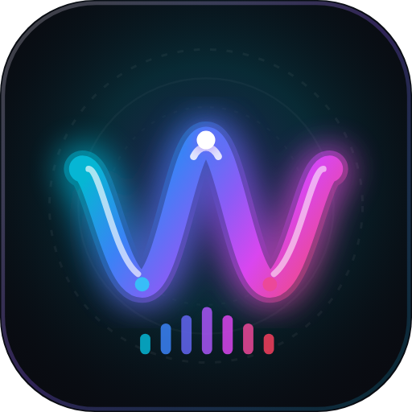

<p align="center">
  
</p>

<h1 align="center">WAVEN — Local Music Player for Android & Web</h1>

<p align="center">
  <strong>A modern, privacy-first local audio player featuring real-time visualizers, synchronized lyrics, and zero cloud tracking.</strong>
</p>

<p align="center">
  <a href="https://abdur07-svg.github.io/WAVEN-player/"><strong>🌐 Launch Live Web App</strong></a> •
  <a href="https://github.com/Abdur07-svg/WAVEN-player/releases"><strong>📱 Download Android APK</strong></a> •
  <a href="#key-features">Key Features</a> •
  <a href="#getting-started">Getting Started</a>
</p>

---

## Overview

**WAVEN** is a high-performance local music and audio player built for Android and modern web browsers. Designed for audiophiles who value privacy, control, and clean aesthetics, WAVEN plays your local music library directly from your device storage with zero telemetry, zero accounts, and zero cloud tracking.

Whether running as an Android application or as a standalone Progressive Web App (PWA), WAVEN delivers an immersive listening experience with dynamic album art theming, audio frequency visualizers, and synchronized lyrics support.

- **Official Web Application**: [https://abdur07-svg.github.io/WAVEN-player/](https://abdur07-svg.github.io/WAVEN-player/)
- **GitHub Repository**: [https://github.com/Abdur07-svg/WAVEN-player](https://github.com/Abdur07-svg/WAVEN-player)
- **Official Releases (APK)**: [https://github.com/Abdur07-svg/WAVEN-player/releases](https://github.com/Abdur07-svg/WAVEN-player/releases)

---

## Key Features

- **🎧 100% Offline & Private Playback**:
  Plays your local audio files directly from device storage. Zero telemetry, zero analytics tracking, and no internet connection required.
- **🎼 Broad Audio Format Support**:
  Full playback support for MP3, FLAC, WAV, M4A, AAC, OGG, and OPUS files.
- **✨ Real-Time Audio Visualizer**:
  Hardware-accelerated frequency visualizers dynamically synced to the rhythm and beat of your music.
- **🎤 Synchronized Lyrics & Editor**:
  View embedded or imported synchronized lyrics, with a built-in interactive editor to create or fine-tune LRC timestamps.
- **📱 Native Android Integration**:
  Full support for Android `MediaSession`, lockscreen controls, notification shade controls with album artwork, headset/Bluetooth button actions, and persistent background playback.
- **🎨 Dynamic Artwork & Glassmorphism UI**:
  A responsive glassmorphic interface that extracts and dynamically adapts the UI palette to the dominant colors of the currently playing album artwork.
- **📊 Music DNA & Insights**:
  Track your personal listening statistics, favorite genres, top artists, and recent listening history stored securely on your local device.
- **⚡ Smart Queue & Playlist Management**:
  Create and organize custom playlists, reorder playback queues, and toggle shuffle or repeat modes seamlessly.

---

## Installation & Usage

### 1. Android Installation (APK)
1. Navigate to the [Official GitHub Releases](https://github.com/Abdur07-svg/WAVEN-player/releases) page.
2. Download the latest `WAVEN-Music-Player.apk`.
3. Open the downloaded APK on your Android device (Android 7.0+ / API 24+ supported) and confirm installation.
4. Grant storage permissions when prompted to automatically scan and import your local music library.

### 2. Live Web Application
You can use WAVEN directly in any modern desktop or mobile browser without installing anything:
- Visit [https://abdur07-svg.github.io/WAVEN-player/](https://abdur07-svg.github.io/WAVEN-player/)
- Drag and drop audio files or folders into the player window to start listening.

---

## Building from Source

WAVEN uses a custom, lightweight Python build pipeline (leveraging Android SDK `aapt2`, `d8`, and `zipalign`) that produces optimized release APKs without requiring Gradle.

### Prerequisites
- Python 3.10+
- Java JDK 17
- Android SDK (API 34 platform & build-tools 34.0.0)

### Local Build Steps
1. Clone the repository:
   ```bash
   git clone https://github.com/Abdur07-svg/WAVEN-player.git
   cd WAVEN-player
   ```
2. Install Python dependencies:
   ```bash
   pip install -r requirements.txt
   ```
3. Set up your release signing credentials in `.env`:
   ```env
   WAVEN_KEYSTORE_PASSWORD=your_keystore_password
   WAVEN_KEY_ALIAS=waven_music
   WAVEN_KEYSTORE_PATH=android-mobile/.keystore/waven_release.keystore
   ```
4. Build the signed release APK:
   ```bash
   python build_waven_apk.py
   ```
5. The verified, signed release APK is generated at:
   ```
   dist/WAVEN-Music-Player.apk
   ```

---

## Recommended Repository Topics

To improve search visibility and discoverability on GitHub and search engines, add the following topics in your repository settings:

`waven` • `waven-music-player` • `music-player` • `android-music-player` • `audio-player` • `local-music-player` • `offline-music-player` • `web-audio-api` • `audio-visualizer` • `lyrics-player` • `pwa` • `javascript`

---

## License

This project is released under the [MIT License](LICENSE).

