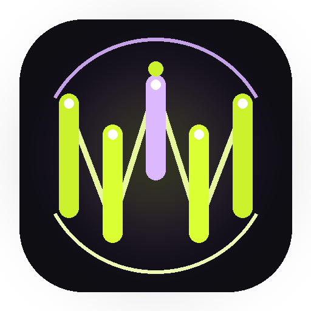

<p align="center">
  
</p>

<h1 align="center">WAVEN — Nocturne Pulse Music Player</h1>

<p align="center">
  <strong>Dark Luxury Local Music Player &amp; DSP Equalizer for Android. Bit-perfect 24-bit/192kHz audio engine, 6-band parametric EQ, real-time synchronized lyrics, lock-screen MediaSession, and zero telemetry.</strong>
</p>

<p align="center">
  <a href="https://abdur07-svg.github.io/WAVEN/"><strong>🌐 Live Landing Page</strong></a> •
  <a href="https://abdur07-svg.github.io/WAVEN/downloads/waven-latest.apk"><strong>📱 Download Android APK</strong></a> •
  <a href="https://github.com/Abdur07-svg/WAVEN"><strong>💻 GitHub Repository</strong></a>
</p>

---

## 1. Project Deliverables

WAVEN consists strictly of **TWO production deliverables**:

1. **Responsive Promotional Website (`index.html` & `web/`)**:
   - Single responsive landing page deployed to **GitHub Pages**.
   - Desktop viewports receive a luxury desktop showcase with interactive screen previews, specifications, comparison tables, and mobile QR code.
   - Mobile viewports receive a thumb-optimized mobile layout with high-contrast typography, screenshot swipe carousel, 3-step installation guide, and sticky bottom download bar.
   - **Promotional & Download Portal Only**: Contains **NO** audio playback, **NO** web player, and **NO** streaming overhead.
   - **Direct APK Download**: Primary CTA immediately downloads `waven-latest.apk` (v1.0.3 Stable, Ultra-Lightweight).

2. **Native Android Music Player (`android-app/`)**:
   - Genuine installable Android APK (`com.waven.musicplayer`).
   - High-fidelity **Nocturne Pulse** UI built with HTML, CSS, and JavaScript inside Android WebView.
   - Real native Android Java backend managing `MediaStore` audio queries, foreground playback service, `MediaSessionCompat`, lock-screen media controls, notification shade controls, and Bluetooth headphone disconnect handling.
   - Exclusively a **Local Music Player** with 100% offline playback, zero accounts, and zero telemetry.
   - Modular architecture ready for future online streaming plug-ins without rewriting the player.

---

## 2. Directory Structure

```text
WAVEN/
├── android-app/                          # Complete Android Studio Project
│   ├── app/
│   │   ├── src/main/
│   │   │   ├── AndroidManifest.xml       # Full permissions & service registrations
│   │   │   ├── java/com/waven/musicplayer/
│   │   │   │   ├── MainActivity.java     # WebView controller, edge-to-edge UI & permissions
│   │   │   │   ├── WavenNativeBridge.java# Bidirectional JavaScript-Java bridge
│   │   │   │   ├── WavenPlaybackService.java # Foreground playback service & MediaSession
│   │   │   │   ├── MediaActionReceiver.java  # Notification & Bluetooth headset receiver
│   │   │   │   ├── AudioScanner.java     # High-speed MediaStore local device scanner
│   │   │   │   └── GenericFileProvider.java # Secure content provider
│   │   │   ├── assets/                   # Music Player UI (HTML5/CSS/JS)
│   │   │   │   ├── index.html            # All 7 Nocturne Pulse screens
│   │   │   │   ├── css/style.css         # Glassmorphic themes & animations
│   │   │   │   └── js/
│   │   │   │       ├── app.js            # View router & component coordinator
│   │   │   │       ├── player.js         # Playback state, queue, shuffle & repeat
│   │   │   │       ├── audio-engine.js   # 6-band DSP EQ & native audio bridge
│   │   │   │       ├── library.js        # Local tracks, favorites & playlists
│   │   │   │       └── lyrics.js         # Synchronized karaoke highlighter
│   │   │   └── res/                      # Launcher icons, colors, styles, XML configs
│   │   ├── build.gradle
│   │   └── proguard-rules.pro
│   ├── build.gradle
│   ├── gradle.properties
│   ├── settings.gradle
│   ├── gradlew                           # Linux/macOS Gradle wrapper script
│   ├── gradlew.bat                       # Windows Gradle wrapper script
│   └── gradle/wrapper/gradle-wrapper.properties
│
├── web/                                  # GitHub Pages Publishing Directory
│   ├── index.html                        # Single responsive landing page
│   ├── assets/img/                       # Optimized WebP/PNG logos & UI screenshots
│   ├── downloads/waven-latest.apk        # Distribution APK
│   ├── robots.txt                        # Search engine crawling rules
│   ├── sitemap.xml                       # Valid XML sitemap for Search Console
│   ├── 404.html                          # Branded error page
│   └── manifest.webmanifest              # Web application manifest
│
├── downloads/
│   └── waven-latest.apk                  # Root distribution copy of APK
├── assets/                               # Global logos, icons, covers & screenshots
├── index.html                            # Root responsive landing page (mirrors web/index.html)
├── robots.txt                            # Search engine directive
├── sitemap.xml                           # Canonical sitemap
├── 404.html                              # Root 404 handler
├── manifest.webmanifest                  # Root PWA manifest
├── build_waven_apk.py                    # Automated standalone APK compiler & verifier
├── README.md                             # Documentation & user guide
└── .gitignore                            # Build artifacts & temp files ignore list
```

---

## 3. Nocturne Pulse UI Design System (Android App)

The Android application implements all screens from the provided `stitch_waven_ui_ux_application` reference specifications:

| Screen | File / Identifier | Description & Features |
| :--- | :--- | :--- |
| **Home Screen** | `view-home` | Quick picks, greeting, recently added tracks, Flow carousel, and navigation shortcuts. |
| **Explore Screen** | `view-explore` | High-voltage discovery chips, curated genre mixes, and trending local library picks. |
| **Library Screen** | `view-library` | High-speed track catalog with tabs for Songs, Artists, Albums, and Playlists, plus real-time search. |
| **Now Playing** | `view-now-playing` | Fullscreen atmospheric vinyl backdrop, dynamic blur, real-time scrubber, shuffle/repeat, EQ & lyrics shortcuts. |
| **Synchronized Lyrics** | `view-lyrics` | Fullscreen karaoke view with syllable cadence indicators and synchronized line highlighting. |
| **Playlist Details** | `view-playlist-details` | Playlist art header, track counter, play all button, shuffle toggle, and track reordering list. |
| **Equalizer Screen** | `view-equalizer` | 6-band tactile frequency sliders (60Hz, 150Hz, 400Hz, 1kHz, 2.4kHz, 15kHz), sub-bass resonance knob, and presets. |
| **Mini Player** | `mini-player` | Persistent floating capsule displaying album art, title, artist, play/pause toggle, and progress bar. |
| **Floating Dock** | `floating-dock` | Quick bottom navigation bar accessing Home, Explore, Library, and Equalizer. |

---

## 4. Android Native Features & Permissions

### Permissions
- `android.permission.READ_MEDIA_AUDIO` (Android 13+ / API 33+)
- `android.permission.READ_EXTERNAL_STORAGE` (Android 8.0 to 12 / API 26-32)
- `android.permission.POST_NOTIFICATIONS` (Android 13+ for playback controls)
- `android.permission.FOREGROUND_SERVICE` & `FOREGROUND_SERVICE_MEDIA_PLAYBACK`
- `android.permission.WAKE_LOCK` (audio continuity with screen locked)

### Audio Engine Capabilities
- **Direct MediaStore Querying**: Native Java `AudioScanner` queries `MediaStore.Audio.Media.EXTERNAL_CONTENT_URI` retrieving title, artist, album, duration, data URI, album art, and date added in milliseconds.
- **Android MediaSession Integration**: Full `MediaSession` with `PlaybackState` updates (Playing, Paused, Buffering). Lock screen displays track metadata, album artwork, and interactive controls (Previous, Play/Pause, Next).
- **Foreground Playback Service**: `WavenPlaybackService` runs as an official media playback foreground service, preventing Android from killing playback when the app is in the background or screen is off.
- **Audio Focus & Bluetooth**: Handles `AudioManager.OnAudioFocusChangeListener` for incoming phone calls, GPS navigation, and registers `ACTION_AUDIO_BECOMING_NOISY` to auto-pause immediately when Bluetooth headphones or cables are unplugged.

---

## 5. Building the WAVEN APK

### Method A: Standalone Python Script (Automated CLI)
WAVEN includes an automated, deterministic compiler script that requires only the Android SDK build-tools and JDK 17:

```powershell
python build_waven_apk.py
```

This script automatically executes:
1. `aapt2 compile` on all resource drawables and XML files.
2. `aapt2 link` with Android 34 platform JAR.
3. `javac` compilation of all native Java files.
4. `d8` Dalvik bytecode conversion.
5. 4-byte zip alignment via `zipalign`.
6. Cryptographic signing via `apksigner` (v1, v2, and v3 schemes).
7. Audit verification: validates APK size, zip alignment, badging, and signatures.
8. Automatically updates `web/downloads/waven-latest.apk` and `downloads/waven-latest.apk`.

### Method B: Android Studio / Gradle
1. Open Android Studio.
2. Select **Open an Existing Project** and navigate to `WAVEN/android-app`.
3. Allow Gradle to sync.
4. Run `Build -> Build Bundle(s) / APK(s) -> Build APK(s)` or execute:
   ```bash
   ./gradlew assembleRelease
   ```
5. Output APK is placed in `android-app/app/build/outputs/apk/release/`.

---

## 6. GitHub Pages Deployment & SEO

The website is fully configured for deployment on **GitHub Pages**:

- **Entry Point**: Root `index.html` (and `web/index.html`).
- **Responsive Layout**: Desktop visitors receive the desktop showcase; mobile visitors receive the thumb-friendly mobile layout.
- **Zero Local Server Dependency**: Uses relative paths (`./`, `assets/`, `downloads/`). Works seamlessly under any custom domain or repository base path (`https://abdur07-svg.github.io/WAVEN/`).
- **Google Search Console**:
  - Verification tag preserved: `<meta name="google-site-verification" content="OVGVId5yYSPGElWHOadcBO1U7rOTmApUfcFklXKdHbQ" />`
  - Valid XML sitemap accessible at: `https://abdur07-svg.github.io/WAVEN/sitemap.xml`
  - Permissive robots directive at: `https://abdur07-svg.github.io/WAVEN/robots.txt`
  - JSON-LD `SoftwareApplication` structured schema for search snippet enrichment.
  - Custom `404.html` error page that seamlessly guides visitors back to the home portal.

---

## 7. Future Online Music Streaming Architecture

WAVEN is intentionally architected to support future online streaming without touching the core UI or player layer:
- The UI communicates through an abstract player controller (`player.js`).
- Track objects contain a standard schema:
  ```javascript
  {
    id: "track_id",
    title: "Track Title",
    artist: "Artist Name",
    album: "Album Name",
    duration: 215,
    uri: "content://... or https://streaming-url.com/stream.mp3",
    source: "local" // Can be extended to "online", "audius", "custom-stream"
  }
  ```
- Adding streaming in a future update simply requires implementing a network data provider feeding into the existing playback pipeline.

---

## 8. License

WAVEN is released under the **Apache License 2.0**.
Free, open-source, and privacy-respecting audio software for everyone.
